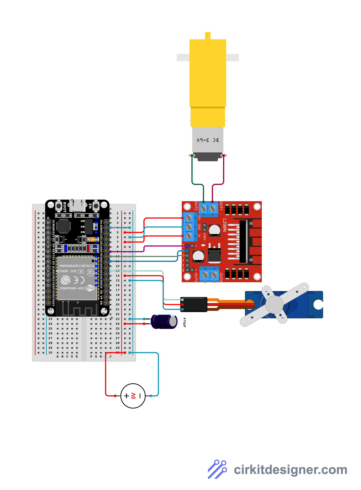
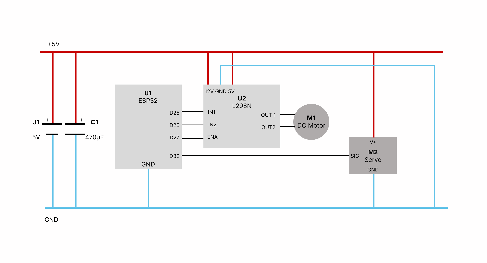
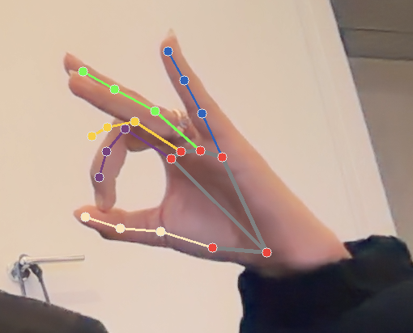
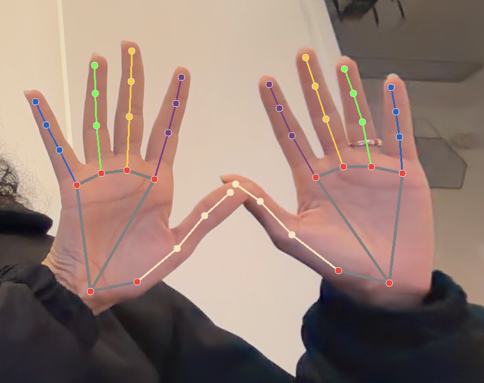
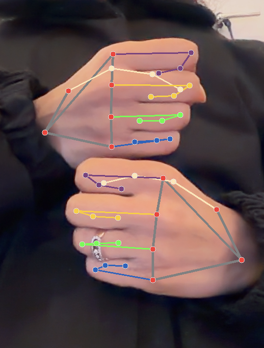
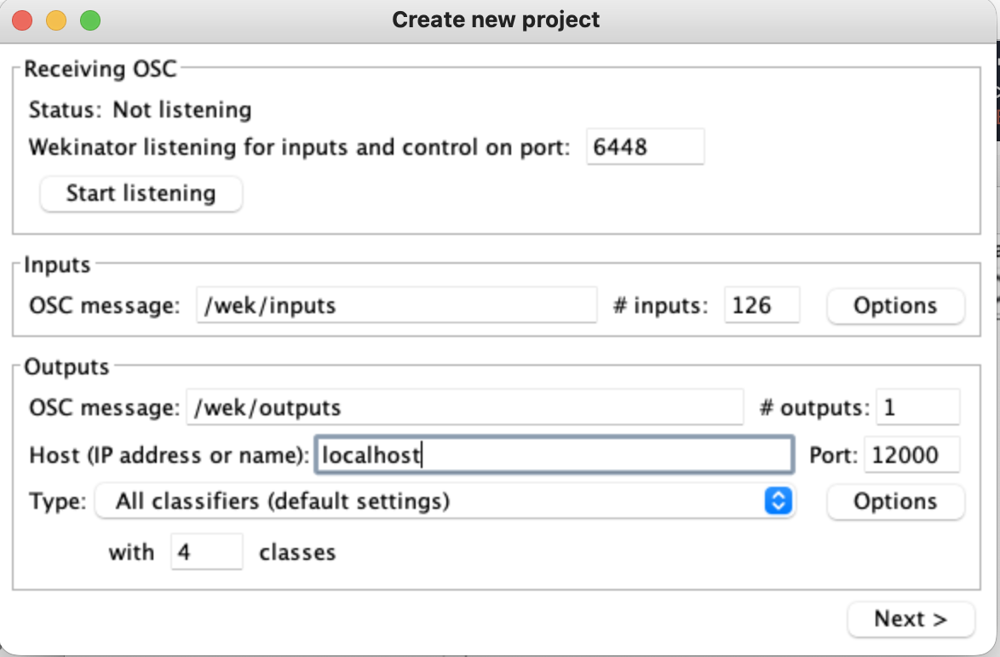

# Electronics and Software Setup

These are the diagrams for how we wired our squid. If you take the suggested improvements in the Equipment Footnotes section of the [README](../README.md) (e.g. swapping the motors for more powerful ones), your wiring may need to change.

## Components

- Breadboard
- ESP32 DevKit V1 (30-pin)
- DC motor
- L298N driver board
- FS90R continuous rotation servo
- Power board (5V, fed by a USB power bank)
- 470µF capacitor
- Jumper wires

## Wiring Diagram

<p align="center">
  
</p>

## Circuit Diagram

<p align="center">
  
</p>

> [!NOTE]
> - The ESP32 is powered by USB from the laptop. VIN is not connected and GND connects to the ground rail.
> - On the L298N, remove the **5V-EN** and **ENA** jumpers.
> - On the power board, set the **current limit jumper (J4) to 2A**.
> - The 470µF capacitor is polarised: its **striped leg goes to GND**.

## Wekinator

You can use the gestures below straight away by running [`hand_input.py`](../Code/hand_input.py), opening the project in [`Wekinator/SquidGestures`](../Wekinator/SquidGestures/) from within the Wekinator app, and clicking **Run**.

<table align="center">
  <tr>
    <td align="center"><br>1. Flick</td>
    <td align="center"><br>2. Boo</td>
    <td align="center"><br>3. Squeeze</td>
  </tr>
</table>

### Training your own gestures

To use different gestures, create a new Wekinator project with these settings:

| Setting | Value |
| ----------- | ----------- |
| Input port | 6448 |
| Input message | `/wek/inputs` |
| Number of inputs | 126 (21 hand points × x, y, z × 2 hands) |
| Output message | `/wek/outputs` |
| Output host | `localhost` (or your ESP32's IP address if sending over Wi-Fi) |
| Output port | 12000 |
| Number of outputs | 1 |
| Output type | All classifiers |
| Number of classes | Your number of gestures + 1 (for a "nothing" class) |

<p align="center">
  
</p>

The ESP32 code responds to classes **1–3**, uses **5** as a reset, and treats any other class/number as "nothing". If you add or remove gestures, update the `switch` statement in `respondToHandMovement()` in [`GelTentacleAction.ino`](../Code/GelTentacleAction/GelTentacleAction.ino) to match.

When recording examples:
- **One-handed gestures:** record them with your left hand **and** your right hand, in the same class.
- **Nothing class:** record no hands, hands resting, and casual movement, so the squid doesn't react to everything.
- Aim for a few hundred examples per class (about 10 seconds of recording), then click **Train**.

## Running Everything Together

The full pipeline:

```
Camera → hand_input.py → Wekinator → wek_to_esp32.py → USB cable → ESP32 → motor and servo
```

### 1. Install the software (once)

- **Python packages:**
  ```
  pip3 install mediapipe opencv-python python-osc pyserial
  ```
- **Arduino IDE**, with the **esp32 by Espressif Systems** board package (Boards Manager) and the **ESP32Servo** library (Library Manager).
- **Wekinator**, plus the Java version it requires.

### 2. Check the hand-tracking model (once)

`hand_input.py` uses Google MediaPipe's pre-trained hand model, [`hand_landmarker.task`](../Code/hand_landmarker.task), which is included in the `Code` folder. It finds the 21 points on each hand that are sent to Wekinator.

The model file must stay **in the same folder as `hand_input.py`**, as the script looks for it there. If it's ever missing, download `hand_landmarker.task` from the **Models** section of Google's [MediaPipe Hand Landmarker guide](https://ai.google.dev/edge/mediapipe/solutions/vision/hand_landmarker) and place it in `Code/`.

### 3. Upload the ESP32 code (once, or after code changes)

1. Plug the ESP32 into your computer by USB. Keep the power board **switched off** while uploading.
2. Open [`GelTentacleAction.ino`](../Code/GelTentacleAction/GelTentacleAction.ino) in the Arduino IDE.
3. Select **Tools → Board → ESP32 Dev Module**, and your port under **Tools → Port** (on a Mac, usually `/dev/cu.usbserial-…`).
4. Click **Upload**.

### 4. Set your port in the bridge script (once)

Open [`wek_to_esp32.py`](../Code/wek_to_esp32.py) and set the port to the one you selected in the Arduino IDE:

```python
esp.port = "/dev/cu.usbserial-0001"
```

### 5. Run it

1. **Power:** connect the power bank to the power board, and switch the power board **on**.
2. **ESP32:** connect it to the computer by USB. Close the Arduino IDE's **Serial Monitor**, since the bridge needs the port.
3. **Terminal window 1: the bridge.** From the repo's top folder:
   ```
   python3 Code/wek_to_esp32.py
   ```
   Wait for it to print that it's running, then **press EN** on the ESP32 and wait a few seconds.
4. **Terminal window 2: hand tracking.**
   ```
   python3 Code/hand_input.py
   ```
   A camera window opens, showing the hand skeleton.
5. **Wekinator:** open the app, then **File → Open project** and select the `.wekproj` file in `Wekinator/SquidGestures/`. Check the status bar shows inputs arriving, then click **Run**.
6. **Gesture**, with your hands down in between gestures.

As you gesture, window 1 shows the class received from Wekinator, followed by the ESP32's response, e.g.:

```
Received: 2
ESP32: Gesture 2
ESP32: Case 2
```

To stop, click **Stop** in Wekinator, press **Esc** in the camera window, press **Ctrl+C** in window 1, and switch off the power board.

## Testing

### Motor Test
To test the board and motors on their own:

1. Stop the bridge (**Ctrl+C** in window 1), since the Serial Monitor needs the port.
2. In the Arduino IDE, open **Tools → Serial Monitor** and set it to **115200 baud**.
3. Type a class number (**1**, **2** or **3**) and press Enter. The ESP32 responds just as it would to Wekinator.
4. Type **4** between repeats of the same gesture, since the ESP32 only responds when the gesture changes.
5. Type **5** to reset the syringe to the start.

Close the Serial Monitor before starting the bridge again.

### General Troubleshooting

| Problem | Check |
| ----------- | ----------- |
| `hand_input.py` says it can't find `hand_landmarker.task` | The model file is in `Code/`, next to `hand_input.py`, and is named exactly `hand_landmarker.task` |
| "Resource busy" when starting the bridge | Close the Arduino Serial Monitor, or any other bridge still running |
| ESP32 stops responding after a motor runs | Electrical noise from the motor: add a 0.1µF capacitor across the motor's terminals, keep motor wires away from the ESP32, consider swapping out for more powerful motors. |