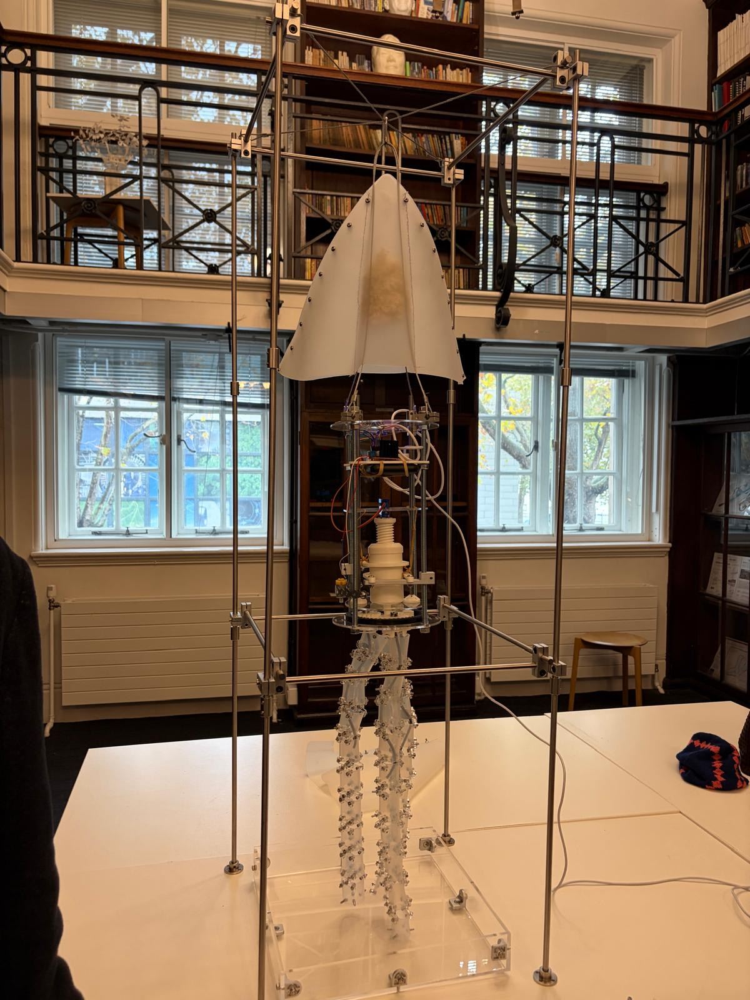
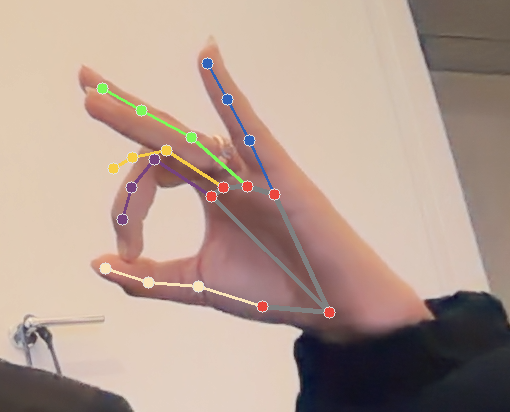
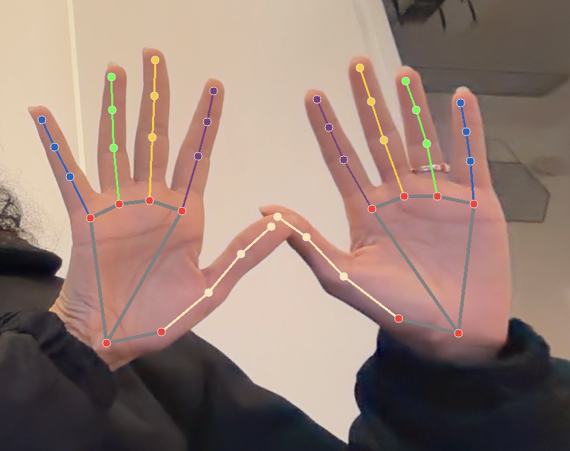
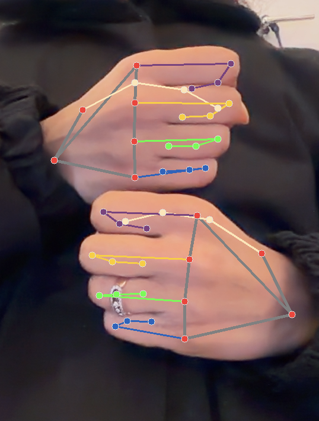

# SquidSquad

  
  

A suspended silicon squid with an internal mechanism to squirt gel and move its tentacles when it’s “scared”. In order to achieve this, we trained a model to recognize hand motions that we felt emulated fear and violence:

<table>
  <tr>
    <td align="center"> 1. Flick</td>
    <td align="center"> 2. Boo</td>
    <td align="center"> 3. Squeeze</td>
  </tr>
</table>

Each of these hand motions was intended to cause variable levels of gel release and tentacle movement individually and create a sensorial representation of the squid’s fear.
Through watching the involuntary gel secretion of a limp, helpless creature, the scarer is forced
to reconcile with the consequences of their actions. This interaction acts as a broader metaphor
for human domination of non-human animals and our methods for extracting natural resources.

> [!NOTE]
> For detailed instructions on wiring and running the code, see [ELECTRONICSOFTWARESETUP.md](Docs/ELECTRONICSOFTWARESETUP.md).
>
> For building the physical squid, see [Build-Instructions.pdf](Docs/Build-Instructions.pdf).

# Software Used
| Software | Version |
| ----------- | ----------- |
| Arduino IDE | 2.3.10 |
| VS Code (or any equivalent IDE) | 1.142.0 |
| Rhino | 8 |
| Illustrator | 29.8.4 |
| OrcaSlicer | 2.4.2 |
| Wekinator | 2.1.0.4 |

# Directory of Resources
| Folder | Filename | Description |
| ----------- | ----------- | ----------- |
| DigitiallyAidedMaking | | Files for the CADded and laser cut parts of the projects. |
| Code | | Python for hand tracking and forwarding the gestures to the ESP32, as well as the Arduino sketch that drives the motor and servo. |
| Docs | [Build-Instructions.pdf](Build-Instructions.pdf) | How to assemble the physical components of the squid. |
| | [ELECTRONICSOFTWARESETUP.md](Docs/ELECTRONICSOFTWARESETUP.md) | How to wire the ESP32 and necessary components, and actually use the whole software pipeline from the hand input all the way to the board. |
| | Images | Diagrams and photos used in the documentation. The Process subfolder contains documentation of our prototypes as well as general steps.|
| Wekinator | | Wekinator project trained with our pre-selected hand gestures.|

# Equipment

### Frame

| Qty | Item |
| --- | ----------- | 
| 16 | 8mm steel rods, 40cm length |
| 8 | 8mm couplers |
| 8 | Linear rod brackets |
| 4 | 8mm flange couplers |

### Internal Frame

| Qty | Item | File |
| --- | ----------- | ----------- |
| 2 | 6mm steel rods, 30cm length | |
| 4 | 8mm threaded rods, 30cm length | |
| 4 | Linear rod brackets | |
| 1 | 16cm acrylic top plate | [Top_base_plate.ai](DigitallyAidedMakingFiles/Top_base_plate.ai) |
| 1 | 16cm acrylic base plate | [Top_base_plate.ai](DigitallyAidedMakingFiles/Top_base_plate.ai)|
| 1 | 12cm x 8cm acrylic rectangular servo plate | [syringe_assembly.ai](DigitallyAidedMakingFiles/syringe_assembly.ai) |
| 1 | 12mm acrylic syringe plate | [syringe_assembly.ai](DigitallyAidedMakingFiles/syringe_assembly.ai) |
| 1 | Battery and board holder | [battery_holder.stl](DigitallyAidedMakingFiles/battery_holder.stl) |
| 1 | 5V power bank1 | |
| 1 | Breadboard2 | |
| 1 | Arduino Nano or ESP323 | |
| 12 | Jumper wires | |

### Mechanism Components

| Qty | Item | File |
| --- | ----------- | ----------- |
| 1 | Syringe | [Syringe.stl](DigitallyAidedMakingFiles/Syringe.stl), [syringe_screw.stl](DigitallyAidedMakingFiles/syringe_screw.stl) |
| 1 | Syringe bracket | [syringe_holder.stl](DigitallyAidedMakingFiles/syringe_holder.stl) |
| 1 | Planetary gears | [planet_gear.stl](DigitallyAidedMakingFiles/Planet_gear.stl), [ring_gear.stl](DigitallyAidedMakingFiles/Ring_gear.stl) |
| 120 | Chain links | [chain_links.stl](DigitallyAidedMakingFiles/chain_links.stl) |
| 1 | Tentacle bottom bracket | [Tentacle_bracket.stl](DigitallyAidedMakingFiles/Tentacle_bracket.stl) |
| 1 | O-ring | |
| 3 | 4mm rods, twisted into helices4 | |
| 3 | 5mm bearings | |
| 210cm | Silicone tubing, cut into 7cm sections | |
| 1 | Servo5 | |
| 1 | DC motor6 | |
| 1 | L298N driver board | |
| 1 | Power board | |

### Casing

| Item |
| ----------- |
| Silicone sheets |
| Thread |
| Bolts |

### Additional

| Item |
| ----------- |
| Hair gel |

### Equipment Footnotes

1. Choose a lighter, cylindrical power bank if possible.
2. Substitute a stripboard, and solder the components.
3. For an entirely contained system (without wires coming out of the silicone casing), use an ESP32 over Wi-Fi. [`GelTentacleAction.ino`](Code/GelTentacleAction/GelTentacleAction.ino) and [`wek_to_esp32.py`](Code/wek_to_esp32.py) will need to be adapted accordingly.
4. These added a lot of weight to the tentacles. Swap them for something lighter, so the tentacles don't add unnecessary load on the motor.
5. Swap for a stepper motor. In our final iteration, the servo didn't have enough torque to consistently screw in the syringe without shorting the circuit.
6. Swap for a stepper motor. In our final iteration, we also needed more torque to move the planetary gears.